# Design Document: Aplicativo de Resgate de Animais (animal-rescue-app)

## Overview

O **animal-rescue-app** é uma plataforma web/mobile que conecta pessoas, protetores (ONGs, abrigos e protetores independentes) e adotantes em torno do resgate e da adoção responsável de animais. A aplicação permite que animais resgatados sejam cadastrados e publicados para adoção, que o público pesquise e filtre animais disponíveis, que adotantes enviem pedidos de adoção, e que protetores e administradores gerenciem todo o ciclo de vida do processo.

O sistema cobre quatro perfis de usuário — **Visitante**, **Adotante**, **Protetor** e **Administrador** — cada um com permissões distintas. Protetores precisam ser verificados por um administrador antes de publicar animais. Qualquer pessoa autenticada (adotante/visitante registrado) pode **reportar um animal que precisa de resgate**, informando localização e fotos, iniciando o fluxo de resgate. Os pedidos de adoção seguem uma **máquina de estados** com regras de concorrência: ao aprovar um pedido, os demais pedidos pendentes para o mesmo animal são automaticamente rejeitados e o animal é marcado como adotado.

**Pilha tecnológica escolhida (e justificativa resumida):**
- **Frontend Web + Mobile:** React (Next.js) para web e React Native (Expo) para mobile — reuso de lógica TypeScript entre plataformas e grande ecossistema. *Suposição:* o produto precisa de presença web pública (SEO para páginas de animais) e app mobile para protetores/adotantes em campo.
- **Backend:** API em TypeScript (Node.js + NestJS) com camada REST/HTTP — tipagem compartilhada com o frontend reduz divergências de contrato.
- **Banco de dados:** PostgreSQL (relacional) — os dados são fortemente relacionais (usuários, animais, pedidos, protetores) e precisam de integridade transacional, especialmente na aprovação de adoções.
- **Armazenamento de mídia:** armazenamento de objetos (ex.: S3-compatível) para fotos de animais e de denúncias; o banco guarda apenas URLs/metadados.
- **Autenticação:** JWT com refresh tokens e autorização baseada em papéis (RBAC).
- **Notificações:** serviço de notificação assíncrono (e-mail/push) desacoplado por eventos de domínio.

*Observação:* As decisões acima são suposições razoáveis para um app de resgate e podem ser ajustadas na fase de requisitos.

## Architecture

A arquitetura segue um padrão em camadas com API central, separando apresentação, lógica de domínio e persistência. Eventos de domínio disparam notificações de forma assíncrona.

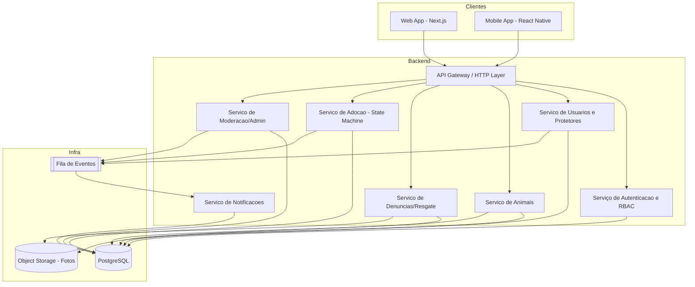

**Fluxo de resgate e adoção (visão de alto nível):**

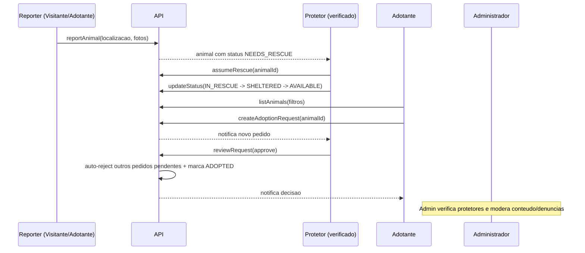

## Components and Interfaces

### Componente 1: Serviço de Autenticação e RBAC

**Propósito:** Registrar usuários, autenticar credenciais, emitir/renovar tokens e autorizar ações com base no papel.

**Interface:**
```typescript
type Role = "VISITOR" | "ADOPTER" | "PROTECTOR" | "ADMIN";

interface AuthService {
  register(input: RegisterInput): Promise<AuthResult>;
  login(credentials: Credentials): Promise<AuthResult>;
  refresh(refreshToken: string): Promise<AuthResult>;
  authorize(userId: string, action: Action, resource: Resource): boolean;
}
```

**Responsabilidades:**
- Validar e armazenar credenciais com hash seguro.
- Emitir JWT de acesso e refresh token.
- Avaliar permissões por papel antes de cada operação sensível.

### Componente 2: Serviço de Usuários e Protetores

**Propósito:** Gerenciar perfis de usuário e o processo de verificação de protetores pelo administrador.

**Interface:**
```typescript
interface UserService {
  getProfile(userId: string): Promise<UserProfile>;
  updateProfile(userId: string, patch: Partial<UserProfile>): Promise<UserProfile>;
  requestProtectorVerification(userId: string, docs: VerificationDocs): Promise<ProtectorApplication>;
  decideProtectorVerification(adminId: string, applicationId: string, decision: "APPROVE" | "REJECT", reason?: string): Promise<ProtectorApplication>;
}
```

**Responsabilidades:**
- Manter dados de perfil e papel do usuário.
- Processar solicitações de verificação de protetor e promover o papel para `PROTECTOR` quando aprovado.

### Componente 3: Serviço de Animais

**Propósito:** CRUD de animais, gerenciamento de mídia e transições do ciclo de vida do animal.

**Interface:**
```typescript
interface AnimalService {
  createAnimal(protectorId: string, input: AnimalInput): Promise<Animal>;
  updateAnimal(protectorId: string, animalId: string, patch: Partial<AnimalInput>): Promise<Animal>;
  changeAnimalStatus(actorId: string, animalId: string, next: AnimalStatus): Promise<Animal>;
  listAvailable(filter: AnimalFilter, page: Pagination): Promise<Paged<Animal>>;
  getAnimal(animalId: string): Promise<Animal>;
  addPhotos(protectorId: string, animalId: string, photos: UploadedPhoto[]): Promise<Animal>;
}
```

**Responsabilidades:**
- Garantir que apenas o protetor dono (ou admin) altere o animal.
- Validar transições de status conforme a máquina de estados do animal.
- Expor listagem pública filtrável somente de animais disponíveis.

### Componente 4: Serviço de Denúncias/Resgate

**Propósito:** Receber denúncias de animais que precisam de resgate e vinculá-las ao fluxo de resgate.

**Interface:**
```typescript
interface RescueService {
  reportAnimal(reporterId: string, report: RescueReportInput): Promise<RescueReport>;
  listOpenReports(filter: ReportFilter, page: Pagination): Promise<Paged<RescueReport>>;
  assumeRescue(protectorId: string, reportId: string): Promise<Animal>;
}
```

**Responsabilidades:**
- Registrar denúncia com localização e fotos.
- Permitir que protetor verificado assuma o resgate, criando/ligando um registro de animal com status inicial.

### Componente 5: Serviço de Adoção (Máquina de Estados)

**Propósito:** Gerenciar pedidos de adoção e aplicar as regras de transição e concorrência.

**Interface:**
```typescript
interface AdoptionService {
  createRequest(adopterId: string, animalId: string, message?: string): Promise<AdoptionRequest>;
  cancelRequest(adopterId: string, requestId: string): Promise<AdoptionRequest>;
  reviewRequest(protectorId: string, requestId: string, decision: "APPROVE" | "REJECT", note?: string): Promise<AdoptionRequest>;
  listRequestsForAnimal(animalId: string): Promise<AdoptionRequest[]>;
  listRequestsByAdopter(adopterId: string): Promise<AdoptionRequest[]>;
}
```

**Responsabilidades:**
- Criar pedidos apenas para animais disponíveis.
- Ao aprovar um pedido: rejeitar automaticamente os demais pendentes do mesmo animal e marcar o animal como `ADOPTED`, tudo em uma única transação.

### Componente 6: Serviço de Moderação/Admin

**Propósito:** Verificar protetores, moderar conteúdo/denúncias e tratar reportes de abuso.

**Interface:**
```typescript
interface ModerationService {
  listPendingProtectorApplications(page: Pagination): Promise<Paged<ProtectorApplication>>;
  flagContent(reporterId: string, target: ContentRef, reason: string): Promise<ModerationFlag>;
  resolveFlag(adminId: string, flagId: string, action: ModerationAction): Promise<ModerationFlag>;
}
```

**Responsabilidades:**
- Dar visibilidade de itens pendentes ao admin.
- Aplicar ações de moderação (ocultar animal, suspender usuário, etc.).

### Componente 7: Serviço de Notificações

**Propósito:** Entregar notificações assíncronas a partir de eventos de domínio.

**Interface:**
```typescript
interface NotificationService {
  onDomainEvent(event: DomainEvent): Promise<void>;
  listForUser(userId: string, page: Pagination): Promise<Paged<Notification>>;
  markRead(userId: string, notificationId: string): Promise<void>;
}
```

**Responsabilidades:**
- Reagir a eventos (novo pedido, decisão de adoção, resultado de verificação).
- Persistir e entregar notificações ao destinatário correto.

## Data Models

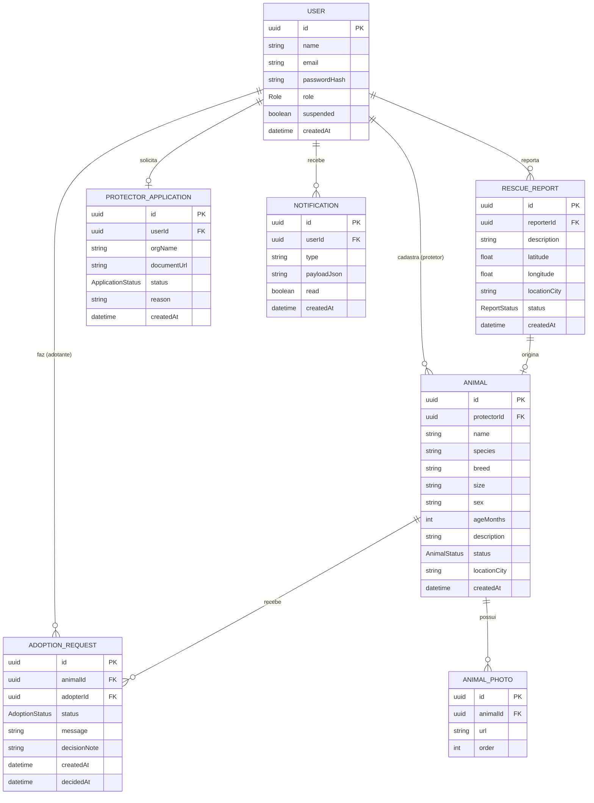

### Tipos e enumerações principais

```typescript
type AnimalStatus =
  | "NEEDS_RESCUE"   // reportado, aguardando resgate
  | "IN_RESCUE"      // protetor assumiu o resgate
  | "SHELTERED"      // em abrigo/lar temporario
  | "AVAILABLE"      // disponivel para adocao
  | "ADOPTED"        // adotado
  | "UNAVAILABLE";   // ocultado/removido da vitrine

type AdoptionStatus =
  | "SENT"
  | "UNDER_REVIEW"
  | "APPROVED"
  | "REJECTED"
  | "CANCELLED";

type ReportStatus = "OPEN" | "ASSUMED" | "CLOSED";
type ApplicationStatus = "PENDING" | "APPROVED" | "REJECTED";

interface Animal {
  id: string;
  protectorId: string | null;
  name: string;
  species: string;
  breed?: string;
  size?: "SMALL" | "MEDIUM" | "LARGE";
  sex?: "MALE" | "FEMALE" | "UNKNOWN";
  ageMonths?: number;
  description: string;
  status: AnimalStatus;
  locationCity: string;
  photos: AnimalPhoto[];
  createdAt: Date;
}

interface AnimalFilter {
  species?: string;
  size?: "SMALL" | "MEDIUM" | "LARGE";
  sex?: "MALE" | "FEMALE";
  locationCity?: string;
  ageMonthsMax?: number;
}
```

**Regras de validação (resumo):**
- `email` único e em formato válido; `passwordHash` nunca exposto em respostas.
- `Animal.description` não vazio; `status` sempre um valor válido do enum.
- `AnimalFilter.ageMonthsMax >= 0` quando informado.
- `RescueReport.latitude ∈ [-90, 90]`, `longitude ∈ [-180, 180]`.
- Listagem pública (`listAvailable`) só retorna animais com `status === "AVAILABLE"`.

## Low-Level Design: Máquinas de Estado e Algoritmos

### Máquina de estados do Animal

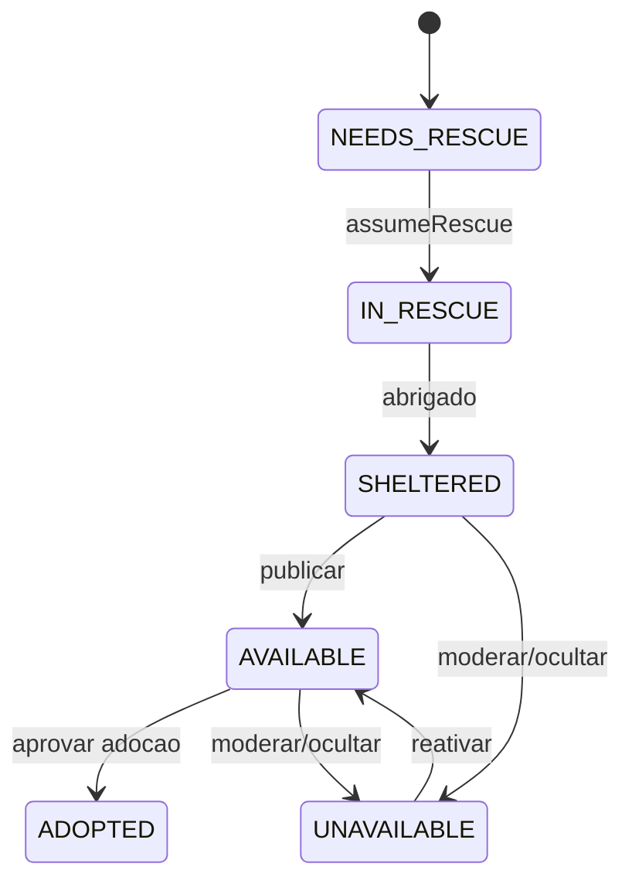

### Máquina de estados do Pedido de Adoção

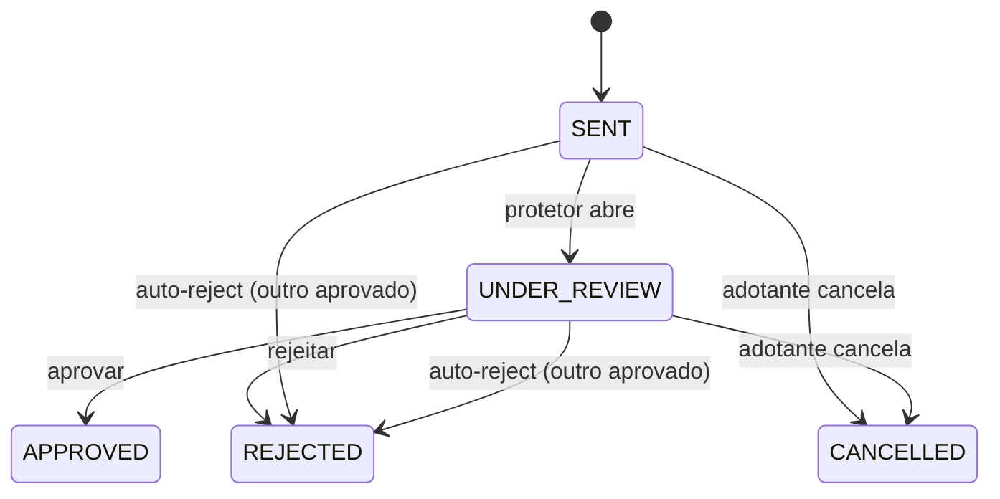

### Transições válidas (tabela de referência)

```typescript
const ANIMAL_TRANSITIONS: Record<AnimalStatus, AnimalStatus[]> = {
  NEEDS_RESCUE: ["IN_RESCUE"],
  IN_RESCUE: ["SHELTERED"],
  SHELTERED: ["AVAILABLE", "UNAVAILABLE"],
  AVAILABLE: ["ADOPTED", "UNAVAILABLE"],
  UNAVAILABLE: ["AVAILABLE"],
  ADOPTED: [],
};

const ADOPTION_TRANSITIONS: Record<AdoptionStatus, AdoptionStatus[]> = {
  SENT: ["UNDER_REVIEW", "CANCELLED", "REJECTED"],
  UNDER_REVIEW: ["APPROVED", "REJECTED", "CANCELLED"],
  APPROVED: [],
  REJECTED: [],
  CANCELLED: [],
};
```

### Key Functions with Formal Specifications

#### Função 1: `createAdoptionRequest`

```typescript
function createAdoptionRequest(adopterId: string, animalId: string, message?: string): Promise<AdoptionRequest>
```

**Preconditions:**
- `adopterId` refere-se a um usuário existente com papel `ADOPTER` e não suspenso.
- `animalId` refere-se a um animal existente com `status === "AVAILABLE"`.
- Não existe pedido ativo (`SENT` ou `UNDER_REVIEW`) do mesmo `adopterId` para o mesmo `animalId`.

**Postconditions:**
- Retorna um `AdoptionRequest` com `status === "SENT"` persistido.
- O status do animal permanece inalterado (`AVAILABLE`).
- Um evento de domínio `ADOPTION_REQUEST_CREATED` é publicado para o protetor dono.

**Loop Invariants:** N/A.

#### Função 2: `reviewRequest` (aprovação com auto-rejeição)

```typescript
function reviewRequest(protectorId: string, requestId: string, decision: "APPROVE" | "REJECT", note?: string): Promise<AdoptionRequest>
```

**Preconditions:**
- `protectorId` é o protetor dono do animal associado ao pedido (ou `ADMIN`).
- O pedido existe e está em `SENT` ou `UNDER_REVIEW`.
- Em caso de `APPROVE`, o animal está em `status === "AVAILABLE"`.

**Postconditions:**
- Se `APPROVE`: o pedido fica `APPROVED`; todos os demais pedidos do mesmo animal em `SENT`/`UNDER_REVIEW` ficam `REJECTED`; o animal fica `ADOPTED`. Tudo aplicado atomicamente (transação).
- Se `REJECT`: apenas o pedido alvo fica `REJECTED`; o animal permanece `AVAILABLE`.
- Eventos de decisão são publicados para os adotantes afetados.

**Loop Invariants:**
- Ao iterar sobre os outros pedidos pendentes para rejeição: todo pedido já processado está em estado terminal (`REJECTED`) e nenhum pedido `APPROVED` adicional foi criado para o mesmo animal.

#### Função 3: `changeAnimalStatus`

```typescript
function changeAnimalStatus(actorId: string, animalId: string, next: AnimalStatus): Promise<Animal>
```

**Preconditions:**
- `actorId` tem permissão sobre o animal (protetor dono ou admin).
- `next ∈ ANIMAL_TRANSITIONS[animal.status]`.

**Postconditions:**
- `animal.status === next`.
- Nenhuma transição inválida é persistida.

**Loop Invariants:** N/A.

### Algorithmic Pseudocode

#### Algoritmo: Aprovação de adoção com concorrência

```pascal
ALGORITHM approveAdoption(protectorId, requestId, note)
INPUT: protectorId, requestId, note
OUTPUT: AdoptionRequest aprovado

BEGIN
  BEGIN TRANSACTION
    request ← db.adoptionRequests.findById(requestId)
    ASSERT request <> NULL
    animal  ← db.animals.findById(request.animalId)

    // Autorizacao
    IF NOT (animal.protectorId = protectorId OR isAdmin(protectorId)) THEN
      ROLLBACK
      RETURN Error("Nao autorizado")
    END IF

    // Precondicoes de estado
    IF animal.status <> "AVAILABLE" THEN
      ROLLBACK
      RETURN Error("Animal nao esta disponivel")
    END IF
    IF request.status NOT IN {"SENT", "UNDER_REVIEW"} THEN
      ROLLBACK
      RETURN Error("Pedido nao esta pendente")
    END IF

    // Aprova o pedido alvo
    request.status ← "APPROVED"
    request.decidedAt ← now()
    request.decisionNote ← note
    db.save(request)

    // Auto-rejeita os demais pendentes do mesmo animal
    others ← db.adoptionRequests.findPending(animal.id, excluding = request.id)
    FOR each r IN others DO
      // Invariante: r ainda esta pendente antes de rejeitar
      ASSERT r.status IN {"SENT", "UNDER_REVIEW"}
      r.status ← "REJECTED"
      r.decidedAt ← now()
      db.save(r)
      publishEvent(ADOPTION_DECISION, r.adopterId, "REJECTED")
    END FOR

    // Marca animal como adotado
    animal.status ← "ADOPTED"
    db.save(animal)

    publishEvent(ADOPTION_DECISION, request.adopterId, "APPROVED")
  COMMIT TRANSACTION

  RETURN request
END
```

#### Algoritmo: Listagem pública filtrável de animais disponíveis

```pascal
ALGORITHM listAvailable(filter, page)
INPUT: filter (criterios opcionais), page (offset, limit)
OUTPUT: pagina de animais

BEGIN
  query ← db.animals.where(status = "AVAILABLE")

  IF filter.species <> NULL THEN query ← query.and(species = filter.species)
  IF filter.size    <> NULL THEN query ← query.and(size = filter.size)
  IF filter.sex     <> NULL THEN query ← query.and(sex = filter.sex)
  IF filter.locationCity <> NULL THEN query ← query.and(locationCity = filter.locationCity)
  IF filter.ageMonthsMax <> NULL THEN
    ASSERT filter.ageMonthsMax >= 0
    query ← query.and(ageMonths <= filter.ageMonthsMax)
  END IF

  total ← query.count()
  items ← query.orderBy(createdAt DESC).offset(page.offset).limit(page.limit)

  // Postcondicao: todo item retornado tem status AVAILABLE
  RETURN { items: items, total: total, page: page }
END
```

### Example Usage

```typescript
// Adotante envia um pedido de adocao
const request = await adoptionService.createRequest(adopterId, animalId, "Tenho quintal grande");

// Protetor aprova: aprova este e auto-rejeita os demais, marca animal adotado
const approved = await adoptionService.reviewRequest(protectorId, request.id, "APPROVE");

// Visitante lista caes pequenos disponiveis em uma cidade
const page = await animalService.listAvailable(
  { species: "dog", size: "SMALL", locationCity: "Fortaleza" },
  { offset: 0, limit: 20 }
);

// Qualquer usuario autenticado reporta um animal que precisa de resgate
const report = await rescueService.reportAnimal(userId, {
  description: "Cao ferido na avenida",
  latitude: -3.73, longitude: -38.52, locationCity: "Fortaleza",
  photos: uploadedPhotos,
});
```

## Correctness Properties

### Property 1: Listagem pública expõe apenas animais disponíveis
Para todo animal retornado por `listAvailable`, seu `status` é igual a `"AVAILABLE"`. Nenhum animal em `NEEDS_RESCUE`, `IN_RESCUE`, `SHELTERED`, `ADOPTED` ou `UNAVAILABLE` aparece na vitrine pública.

**Validates: Requirements 5.1, 5.2**

### Property 2: Transições de estado do animal são sempre válidas
Para toda chamada de `changeAnimalStatus(actor, animal, next)` que é persistida, `next` pertence a `ANIMAL_TRANSITIONS[statusAnterior]`. Nenhuma transição fora da tabela é gravada.

**Validates: Requirements 3.5, 3.6, 3.7**

### Property 3: Aprovação de adoção é mutuamente exclusiva por animal
Para qualquer animal, existe no máximo um `AdoptionRequest` com `status === "APPROVED"`. Ao aprovar um pedido, todos os outros pedidos do mesmo animal que estavam em `SENT` ou `UNDER_REVIEW` passam a `REJECTED`.

**Validates: Requirements 7.3, 7.4**

### Property 4: Aprovação implica animal adotado
Sempre que um `AdoptionRequest` atinge `status === "APPROVED"`, o animal correspondente tem `status === "ADOPTED"`, e ambos os efeitos ocorrem na mesma transação (atomicidade: ou todos aplicados, ou nenhum).

**Validates: Requirements 7.3, 7.5**

### Property 5: Pedidos de adoção só existem para animais disponíveis na criação
Todo `AdoptionRequest` com `status === "SENT"` foi criado quando o animal estava `AVAILABLE`. Não é possível criar pedido para animal que não esteja disponível.

**Validates: Requirements 6.1, 6.2**

### Property 6: Unicidade de pedido ativo por adotante e animal
Para qualquer par (adotante, animal), existe no máximo um pedido em estado ativo (`SENT` ou `UNDER_REVIEW`) ao mesmo tempo.

**Validates: Requirements 6.3**

### Property 7: Apenas protetores verificados publicam animais
Qualquer animal com `status === "AVAILABLE"` possui um `protectorId` cujo usuário tem papel `PROTECTOR` resultante de uma verificação aprovada por um administrador.

**Validates: Requirements 2.4, 3.1, 3.8**

### Property 8: Autorização por papel é respeitada
Para toda operação sensível (cadastrar/alterar animal, revisar pedido, verificar protetor, moderar), o ator possui o papel exigido; caso contrário a operação é rejeitada sem efeitos colaterais.

**Validates: Requirements 1.6, 1.7, 2.6, 3.4, 4.6, 7.1, 8.4**

### Property 9: Transições de pedido de adoção são válidas
Para toda mudança de status de `AdoptionRequest` persistida, o novo estado pertence a `ADOPTION_TRANSITIONS[estadoAnterior]`. Estados terminais (`APPROVED`, `REJECTED`, `CANCELLED`) não transitam para outros estados.

**Validates: Requirements 6.5, 6.6**

### Property 10: Notificações são entregues aos destinatários corretos
Para todo evento de decisão de adoção, de novo pedido e de resultado de verificação, uma notificação é criada e endereçada exatamente ao usuário afetado (adotante, protetor ou solicitante), e não a outros usuários.

**Validates: Requirements 9.1, 9.2, 9.3, 9.4**

## Error Handling

### Cenário 1: Aprovação concorrente do mesmo animal
**Condição:** Dois protetores/admins tentam aprovar pedidos diferentes do mesmo animal simultaneamente.
**Resposta:** A transação usa bloqueio/condição sobre `animal.status === "AVAILABLE"`; a segunda transação falha ao verificar a precondição e retorna erro de conflito.
**Recuperação:** O segundo ator recebe mensagem indicando que o animal já foi adotado; a lista é recarregada.

### Cenário 2: Pedido de adoção para animal indisponível
**Condição:** Adotante envia pedido para animal já adotado/oculto.
**Resposta:** `createRequest` retorna erro de validação (`ANIMAL_NOT_AVAILABLE`) sem persistir nada.
**Recuperação:** UI atualiza o status do animal e informa o adotante.

### Cenário 3: Transição de status inválida
**Condição:** Tentativa de mudar o animal para um estado fora da tabela de transições.
**Resposta:** `changeAnimalStatus` rejeita com erro `INVALID_TRANSITION`.
**Recuperação:** Nenhuma mudança é gravada; estado atual é mantido.

### Cenário 4: Ação sem permissão
**Condição:** Usuário sem papel adequado tenta operação restrita (ex.: visitante cadastrando animal).
**Resposta:** `authorize` retorna falso; a API responde `403 Forbidden`.
**Recuperação:** UI oculta/desabilita a ação para papéis não autorizados.

### Cenário 5: Falha no upload de mídia
**Condição:** O armazenamento de objetos falha ao receber as fotos.
**Resposta:** A operação de cadastro é revertida e nenhuma URL inválida é persistida.
**Recuperação:** Usuário é instruído a tentar novamente; cadastros parciais não são salvos.

### Cenário 6: Dados de denúncia inválidos
**Condição:** Coordenadas fora de faixa ou descrição vazia.
**Resposta:** `reportAnimal` retorna erro de validação.
**Recuperação:** Formulário destaca os campos inválidos.

## Testing Strategy

### Unit Testing Approach
Testar isoladamente: validação de transições (`ANIMAL_TRANSITIONS`, `ADOPTION_TRANSITIONS`), regras de autorização por papel, validação de entrada (e-mail, coordenadas, filtros), e a lógica de decisão de `reviewRequest` com mocks de repositório. Meta: cobrir todos os ramos das máquinas de estado e dos erros mapeados.

### Property-Based Testing Approach
Usar testes baseados em propriedades para validar invariantes de domínio com entradas geradas aleatoriamente.

**Property Test Library:** fast-check (TypeScript).

Propriedades candidatas a verificação por geração:
- Sequências aleatórias de transições nunca produzem um estado fora da tabela (Properties 2 e 9).
- Para qualquer conjunto de pedidos, após uma aprovação há no máximo um `APPROVED` e o animal fica `ADOPTED` (Properties 3 e 4).
- `listAvailable` sob filtros aleatórios nunca retorna animal não `AVAILABLE` (Property 1).

### Integration Testing Approach
Testes de integração com banco PostgreSQL real (ou container efêmero) para validar atomicidade da aprovação com auto-rejeição sob concorrência, unicidade de pedido ativo e o fluxo completo denúncia → resgate → disponibilização → adoção. Incluir teste de corrida para o Cenário 1 de Error Handling.

## Dependencies

- **Runtime/Backend:** Node.js, NestJS, TypeScript.
- **Banco de dados:** PostgreSQL + ORM com suporte a transações (ex.: Prisma ou TypeORM).
- **Armazenamento de mídia:** serviço de objetos S3-compatível.
- **Autenticação:** biblioteca JWT + hashing de senha (ex.: argon2/bcrypt).
- **Frontend:** Next.js (web), React Native/Expo (mobile).
- **Testes:** Jest (unit/integração) + fast-check (property-based).
- **Notificações:** provedor de e-mail/push e uma fila de eventos para processamento assíncrono.

## Visual Design (UI)

Esta seção documenta a direção visual e o sistema de design da interface **web (Next.js)** do animal-rescue-app. A direção escolhida é **"Confiável e moderno"**: paleta com **azul-petróleo (teal)** como cor primária/institucional e **laranja caloroso** como cor de destaque/ação. O clima é sóbrio, amigável e confiável — adequado a um site de resgate e adoção de animais, onde a confiança do adotante e o destaque às fotos dos animais são essenciais.

> **Observação de escopo:** o design técnico cita web (Next.js) + mobile (React Native). Esta seção foca no **site web**; os tokens de cor, tipografia e espaçamento são agnósticos o suficiente para serem reaproveitados no app mobile com ajustes de densidade.

### 1. Princípios visuais

1. **Acolhedor e confiável** — o teal institucional transmite seriedade e cuidado; o laranja adiciona calor humano sem perder a sobriedade. A interface deve reduzir ansiedade e inspirar segurança em quem adota ou reporta.
2. **A foto do animal é a protagonista** — o layout se apaga para dar espaço às fotos. Cards e páginas de detalhe priorizam imagens grandes e nítidas; cores de UI são suportes, nunca competem com o animal.
3. **Clareza de ações** — toda ação primária (adotar, reportar) usa o laranja de destaque e é inconfundível. Uma cor de ação por vista, hierarquia visual explícita entre primário/secundário/terciário.
4. **Acessibilidade em primeiro lugar** — contraste adequado (alvo WCAG AA), foco visível, área de toque generosa e textos alternativos nas fotos dos animais.
5. **Consistência e economia** — um conjunto pequeno e reutilizável de tokens e componentes; nada de variações ad-hoc de cor ou espaçamento.

### 2. Paleta de cores

A paleta combina o teal institucional (primária) com o laranja de ação (destaque), neutros sóbrios e um conjunto de cores semânticas mapeadas ao ciclo de vida do animal e aos status de adoção.

#### Cores de marca e neutros

| Token | HEX | Uso |
|---|---|---|
| `primary-dark` | `#0F4C5C` | Teal escuro — headers, footer, textos sobre fundo claro que exigem ênfase institucional |
| `primary` (base) | `#15707F` | Teal base — cor institucional principal, links, botão secundário (outline), ícones ativos |
| `primary-light` | `#5FA8B3` | Teal claro — hover de elementos teal, estados ativos suaves |
| `primary-soft` | `#E3F0F2` | Teal suave — fundos de seção/realce, chips neutros, faixas de destaque leve |
| `accent` | `#F08A24` | Laranja de ação — botão primário, CTAs ("Quero adotar", "Reportar"), elementos de ênfase |
| `accent-hover` | `#D9741A` | Laranja hover/pressed do botão primário |
| `accent-soft` | `#FDEBD8` | Laranja suave — realces discretos, badges de atenção leve |
| `bg` | `#F7F9FA` | Fundo da aplicação (cinza-azulado muito claro) |
| `surface` | `#FFFFFF` | Superfície de cards, modais e inputs |
| `border` | `#D9E1E4` | Bordas de cards, inputs e divisores |
| `text-primary` | `#1A2B30` | Texto principal (quase preto com leve matiz teal) |
| `text-secondary` | `#5B6B70` | Texto secundário, legendas, placeholders |

#### Cores semânticas — status do animal (ciclo de vida)

Mapeadas ao enum `AnimalStatus` do design de domínio.

| Status (`AnimalStatus`) | Token | HEX | Significado visual |
|---|---|---|---|
| `NEEDS_RESCUE` | `status-needs-rescue` | `#D7263D` | Vermelho de urgência — precisa de resgate |
| `IN_RESCUE` | `status-in-rescue` | `#E8871E` | Âmbar — resgate em andamento |
| `SHELTERED` | `status-sheltered` | `#7A5CC4` | Roxo — abrigado/lar temporário |
| `AVAILABLE` | `status-available` | `#1E9E6A` | Verde — disponível para adoção |
| `ADOPTED` | `status-adopted` | `#15707F` | Teal (primária) — adotado, desfecho positivo institucional |
| `UNAVAILABLE` | `status-unavailable` | `#8A969B` | Cinza — oculto/indisponível na vitrine |

#### Cores semânticas — status de adoção e feedback

Mapeadas ao enum `AdoptionStatus` e a estados genéricos de feedback.

| Conceito | Token | HEX | Uso |
|---|---|---|---|
| Pedido enviado / em revisão (`SENT`, `UNDER_REVIEW`) | `info` | `#2B7FD4` | Azul informativo — pedido em andamento, avisos neutros |
| Aprovado (`APPROVED`) / sucesso | `success` | `#1E9E6A` | Verde — pedido aprovado, confirmações |
| Rejeitado (`REJECTED`) / erro | `danger` | `#D7263D` | Vermelho — pedido rejeitado, erros de validação |
| Cancelado (`CANCELLED`) / neutro | `neutral` | `#8A969B` | Cinza — pedido cancelado, estados inativos |
| Aviso / atenção | `warning` | `#E8871E` | Âmbar — alertas e pendências |

> **Nota de acessibilidade (contraste):** o alvo é **WCAG AA** (relação de contraste de ~**4.5:1** para texto normal e **3:1** para texto grande/elementos de interface). Cores de fundo claras (`accent`, `accent-soft`, `primary-soft`, `warning`) devem usar **texto escuro** (`text-primary`); cores saturadas escuras (`primary`, `primary-dark`, `danger`, `success`, `info`) comportam **texto branco**. Em badges de status, prefira a cor como **fundo tonalizado + texto na variação escura** ou **cor sólida + texto branco**, nunca cor clara sobre branco puro. **Estes pares de contraste são sugestões e precisam ser verificados** com uma ferramenta de contraste; a conformidade final depende de validação.

#### CSS custom properties

```css
:root {
  /* Marca */
  --color-primary-dark: #0F4C5C;
  --color-primary: #15707F;
  --color-primary-light: #5FA8B3;
  --color-primary-soft: #E3F0F2;

  /* Ação / destaque */
  --color-accent: #F08A24;
  --color-accent-hover: #D9741A;
  --color-accent-soft: #FDEBD8;

  /* Neutros */
  --color-bg: #F7F9FA;
  --color-surface: #FFFFFF;
  --color-border: #D9E1E4;
  --color-text-primary: #1A2B30;
  --color-text-secondary: #5B6B70;

  /* Status do animal (AnimalStatus) */
  --color-status-needs-rescue: #D7263D;
  --color-status-in-rescue: #E8871E;
  --color-status-sheltered: #7A5CC4;
  --color-status-available: #1E9E6A;
  --color-status-adopted: #15707F;
  --color-status-unavailable: #8A969B;

  /* Feedback / status de adoção */
  --color-info: #2B7FD4;     /* SENT / UNDER_REVIEW */
  --color-success: #1E9E6A;  /* APPROVED */
  --color-danger: #D7263D;   /* REJECTED / erro */
  --color-neutral: #8A969B;  /* CANCELLED */
  --color-warning: #E8871E;  /* aviso */
}
```

### 3. Tipografia

**Família sugerida:** **Inter** (via Google Fonts ou `next/font`), por ser neutra, altamente legível em telas e com bom suporte a pesos. Alternativa de fallback do sistema: `system-ui, -apple-system, "Segoe UI", Roboto, sans-serif`.

| Nível | Tamanho / line-height | Peso | Uso |
|---|---|---|---|
| H1 | 36px / 44px | 700 | Título de página / hero |
| H2 | 28px / 36px | 700 | Títulos de seção |
| H3 | 22px / 30px | 600 | Subtítulos, nome do animal no detalhe |
| H4 | 18px / 26px | 600 | Títulos de card, rótulos de grupo |
| Body | 16px / 24px | 400 | Texto corrido padrão |
| Body-strong | 16px / 24px | 600 | Ênfase inline, rótulos |
| Small | 14px / 20px | 400 | Legendas, metadados (cidade, idade) |
| Caption | 12px / 16px | 500 | Badges, notas auxiliares |

Diretrizes: no máximo dois pesos por tela quando possível; comprimento de linha confortável (~60–75 caracteres) em blocos de texto; números e metadados de animais em `Small`/`Caption`.

```css
:root {
  --font-sans: "Inter", system-ui, -apple-system, "Segoe UI", Roboto, sans-serif;
  --fs-h1: 2.25rem;   --lh-h1: 2.75rem;
  --fs-h2: 1.75rem;   --lh-h2: 2.25rem;
  --fs-h3: 1.375rem;  --lh-h3: 1.875rem;
  --fs-h4: 1.125rem;  --lh-h4: 1.625rem;
  --fs-body: 1rem;    --lh-body: 1.5rem;
  --fs-small: 0.875rem; --lh-small: 1.25rem;
  --fs-caption: 0.75rem; --lh-caption: 1rem;
}
```

### 4. Espaçamento e layout

**Escala de espaçamento (base 4px):** `4, 8, 12, 16, 24, 32, 48, 64`. Use múltiplos da escala para margens, paddings e gaps — nunca valores arbitrários.

| Token | Valor |
|---|---|
| `space-1` | 4px |
| `space-2` | 8px |
| `space-3` | 12px |
| `space-4` | 16px |
| `space-6` | 24px |
| `space-8` | 32px |
| `space-12` | 48px |
| `space-16` | 64px |

**Container e grid responsivo:**
- Largura máxima do container de conteúdo: **1200px**, centralizado, com padding lateral de `space-4` (16px) no mobile e `space-6` (24px) no desktop.
- Breakpoints:
  - **Mobile:** `< 640px` — grid de cards com **1 coluna**.
  - **Tablet:** `640px – 1023px` — **2 colunas**.
  - **Desktop:** `≥ 1024px` — **3 a 4 colunas** (3 na listagem com sidebar de filtros; 4 quando filtros ficam no topo).
- Gap padrão do grid de cards: `space-6` (24px).

**Raios de borda e sombras:**

```css
:root {
  --radius-sm: 6px;    /* inputs, chips */
  --radius-md: 12px;   /* cards, botões */
  --radius-lg: 20px;   /* modais, imagens de hero */
  --radius-full: 9999px; /* badges/pills, avatares */

  --shadow-sm: 0 1px 2px rgba(15, 76, 92, 0.06);
  --shadow-md: 0 4px 12px rgba(15, 76, 92, 0.10);
  --shadow-lg: 0 10px 30px rgba(15, 76, 92, 0.14);

  /* Espaçamento (ver tabela acima) */
  --space-1: 4px;  --space-2: 8px;  --space-3: 12px; --space-4: 16px;
  --space-6: 24px; --space-8: 32px; --space-12: 48px; --space-16: 64px;

  --container-max: 1200px;
}
```

### 5. Componentes de UI

#### Botões

- **Primário (laranja):** fundo `accent`, texto branco, `radius-md`; hover `accent-hover`. Usado para a ação principal da tela ("Quero adotar", "Reportar animal", "Enviar"). Apenas um por vista, idealmente.
- **Secundário (teal outline):** fundo transparente, borda e texto `primary`; hover preenche com `primary-soft`. Ações secundárias ("Ver detalhes", "Cancelar filtro").
- **Texto (terciário):** sem borda nem fundo, texto `primary`; hover sublinhado. Ações de baixa ênfase ("Voltar", "Limpar").
- Estados comuns: `hover`, `active/pressed`, `disabled` (opacidade reduzida, sem sombra), `loading` (spinner + rótulo, desabilitado). Altura mínima **44px** para boa área de toque.

```jsx
// Botão primário (ação) e secundário (teal outline) com Tailwind
<button
  className="inline-flex min-h-[44px] items-center justify-center gap-2 rounded-xl
             bg-[var(--color-accent)] px-5 text-white font-semibold
             hover:bg-[var(--color-accent-hover)] disabled:opacity-50
             focus-visible:outline focus-visible:outline-2 focus-visible:outline-offset-2
             focus-visible:outline-[var(--color-accent)]">
  Quero adotar
</button>

<button
  className="inline-flex min-h-[44px] items-center justify-center rounded-xl
             border border-[var(--color-primary)] px-5 font-semibold
             text-[var(--color-primary)] hover:bg-[var(--color-primary-soft)]
             focus-visible:outline focus-visible:outline-2 focus-visible:outline-offset-2
             focus-visible:outline-[var(--color-primary)]">
  Ver detalhes
</button>
```

#### Card de animal

Estrutura: **foto destacada** (proporção ~4:3, ocupa o topo), **badge de status** sobreposto no canto superior, **nome** (H4), **espécie/porte** e **cidade** como metadados (`Small`/`text-secondary`), e uma ação secundária ("Ver detalhes"). O card inteiro é clicável/linkável para a página de detalhe.

```jsx
// Card de animal
<article className="overflow-hidden rounded-xl border border-[var(--color-border)]
                    bg-[var(--color-surface)] shadow-[var(--shadow-sm)]
                    transition hover:shadow-[var(--shadow-md)]">
  <div className="relative aspect-[4/3]">
    
    {/* Badge de status (AVAILABLE) */}
    <span className="absolute left-3 top-3 rounded-full bg-[var(--color-status-available)]
                     px-3 py-1 text-xs font-semibold text-white">
      Disponível
    </span>
  </div>
  <div className="p-4">
    <h4 className="text-lg font-semibold text-[var(--color-text-primary)]">{animal.name}</h4>
    <p className="mt-1 text-sm text-[var(--color-text-secondary)]">
      {animal.species} · {animal.size} · {animal.locationCity}
    </p>
  </div>
</article>
```

#### Badge / chip de status

Pílula (`radius-full`) usando as cores semânticas de status. Para legibilidade, usar **fundo sólido da cor + texto branco** (status escuros/saturados) ou **fundo tonalizado + texto na cor escura** (status claros). Rótulos em `Caption`/`Small`. Exemplos de mapeamento: `NEEDS_RESCUE` → vermelho "Precisa de resgate"; `IN_RESCUE` → âmbar "Em resgate"; `SHELTERED` → roxo "Abrigado"; `AVAILABLE` → verde "Disponível"; `ADOPTED` → teal "Adotado"; `UNAVAILABLE` → cinza "Indisponível".

#### Campos de formulário

Inputs com `surface`, borda `border`, `radius-sm`, padding `space-3`; label acima em `Small`/`Body-strong`; placeholder em `text-secondary`. Foco com anel visível na cor `primary`. Erros usam borda e mensagem em `danger`; ajuda em `text-secondary`. Campos obrigatórios marcados com asterisco e `aria-required`.

#### Barra de navegação / header

Header fixo com fundo `surface` (ou `primary-dark` na versão institucional), logo à esquerda, navegação central (Início, Animais, Reportar), e à direita: ações de autenticação (Entrar/Registrar) ou avatar + **sino de notificações** com contador. CTA "Reportar animal" em destaque (laranja). Em mobile, navegação colapsa em menu hambúrguer.

#### Filtros de busca

Conjunto de controles para `AnimalFilter`: espécie, porte (SMALL/MEDIUM/LARGE), sexo (MALE/FEMALE), cidade e idade máxima (slider/numérico `ageMonthsMax`). No desktop ficam em **sidebar** à esquerda; no mobile, abrem em um **painel/drawer** acionado por botão "Filtrar". Chips mostram filtros ativos com opção de remover; botão "Limpar filtros" (botão texto).

#### Estados vazios e de carregamento

- **Vazio:** ilustração/ícone discreto + texto explicativo + ação (ex.: "Nenhum animal encontrado com esses filtros — limpar filtros"). Tom acolhedor, nunca culpando o usuário.
- **Carregando:** **skeletons** com a forma do card (bloco de imagem + duas linhas de texto) usando `primary-soft`/`border` em animação sutil; evita saltos de layout. Botões em ação assíncrona mostram spinner e ficam desabilitados.

### 6. Layout das telas principais

#### Home / landing

Hero com headline institucional, imagem/collage de animais e **dois CTAs**: "Adotar um animal" (primário, laranja) e "Reportar animal para resgate" (secundário). Abaixo: faixa de destaques de animais `AVAILABLE` (grid de cards), seção "Como funciona" (resgatar → abrigar → adotar) e rodapé.

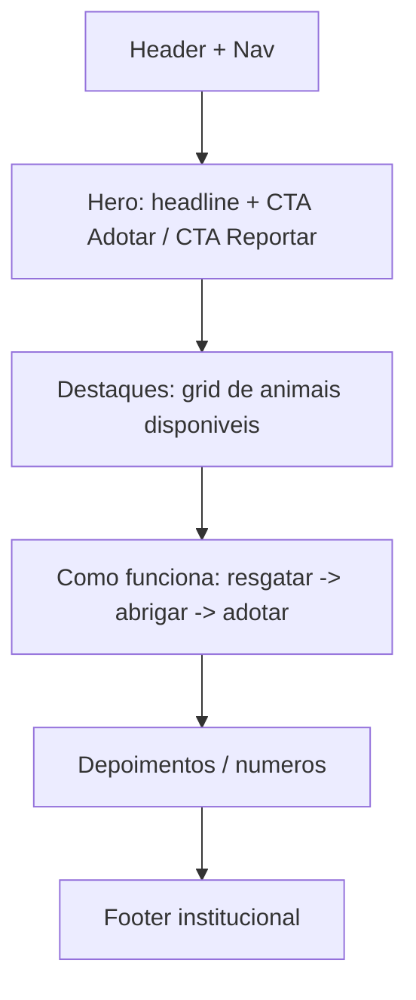

#### Listagem / busca de animais

Sidebar de filtros (desktop) + grid de cards + paginação. Topo com contagem de resultados e ordenação. No mobile, filtros em drawer.

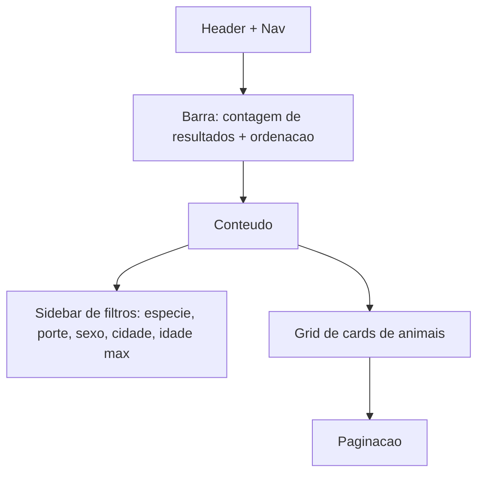

#### Detalhe do animal

Galeria de fotos (principal + miniaturas), bloco de informações (nome, espécie/raça, porte, sexo, idade, cidade), **badge de status**, descrição, **botão "Quero adotar"** (primário, só habilitado quando `AVAILABLE`) e dados do protetor responsável.

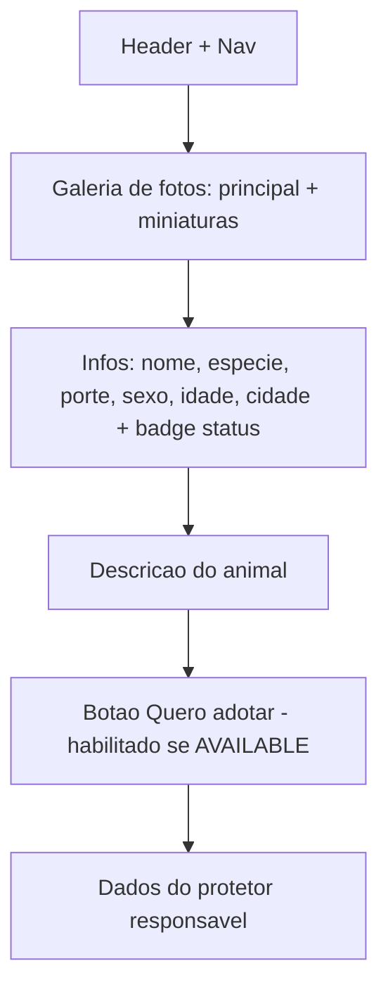

#### Reportar animal para resgate

Formulário com descrição, localização (campo de cidade + **mapa** para marcar latitude/longitude) e **upload de fotos** (múltiplas, com pré-visualização). Validação inline; CTA primário "Enviar denúncia".

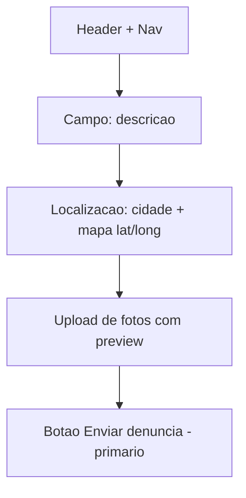

#### Login / Registro

Layout centrado, card único com formulário (e-mail, senha; no registro também nome e confirmação). Alternância entre "Entrar" e "Criar conta". Mensagens de erro em `danger`. Link para recuperar senha.

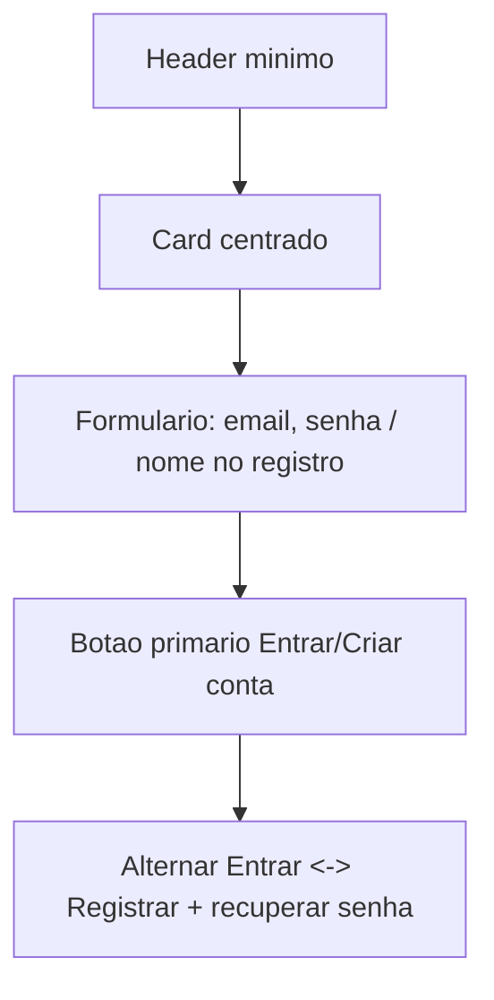

#### Painel do protetor

Área autenticada para o papel `PROTECTOR`: navegação por abas/seções — **Meus animais** (cadastrar/editar, mudar status), **Pedidos recebidos** (aprovar/rejeitar, com auto-rejeição dos demais), **Denúncias assumidas** (acompanhar resgates) — e uma **visão rápida de notificações** (sino com não lidas).

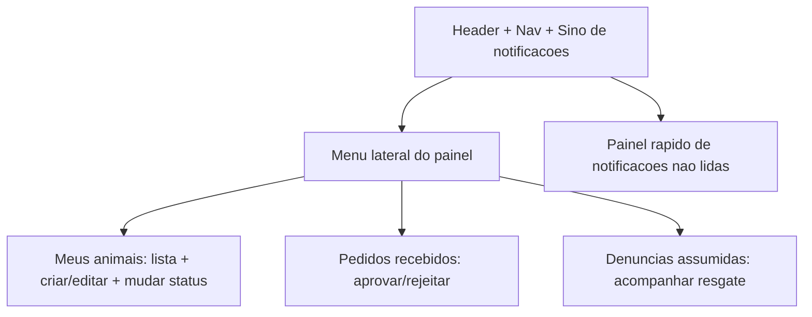

### 7. Acessibilidade e responsividade

- **Contraste:** seguir o alvo **WCAG AA** (~4.5:1 para texto normal, 3:1 para texto grande e elementos de UI). Validar todos os pares cor/fundo com ferramenta de contraste antes de publicar.
- **Área de toque mínima:** alvos interativos de **44×44px** (botões, ícones clicáveis, itens de menu, controles de filtro).
- **Navegação por teclado e foco visível:** toda ação acessível por `Tab`/`Enter`/`Espaço`; anel de foco visível (`outline` na cor `primary`/`accent`); ordem de foco lógica; `Esc` fecha modais e drawers; menus e drawers com `aria-expanded`/`aria-controls`.
- **Textos alternativos:** toda foto de animal recebe `alt` descritivo (ex.: "Foto de Bidu, cão de porte médio"); imagens puramente decorativas usam `alt=""`.
- **Semântica e rótulos:** usar HTML semântico (`header`, `nav`, `main`, `article`), rótulos associados a inputs (`label`/`for`), estados comunicados também por texto/ícone (não só por cor) — especialmente nos badges de status.
- **Responsividade:** o grid de cards adapta colunas por breakpoint (1 / 2 / 3–4); filtros migram de sidebar (desktop) para drawer (mobile); tipografia e espaçamentos fluem na escala definida; imagens com `object-fit: cover` evitam distorção.
- **Movimento:** respeitar `prefers-reduced-motion`, reduzindo animações de skeleton/transição para quem solicita menos movimento.

> **Nota:** estas diretrizes aumentam a acessibilidade, mas **a conformidade WCAG completa exige testes manuais com tecnologias assistivas** (leitores de tela, navegação só por teclado) e revisão por especialista em acessibilidade. Os valores de contraste sugeridos são pontos de partida e devem ser verificados.
